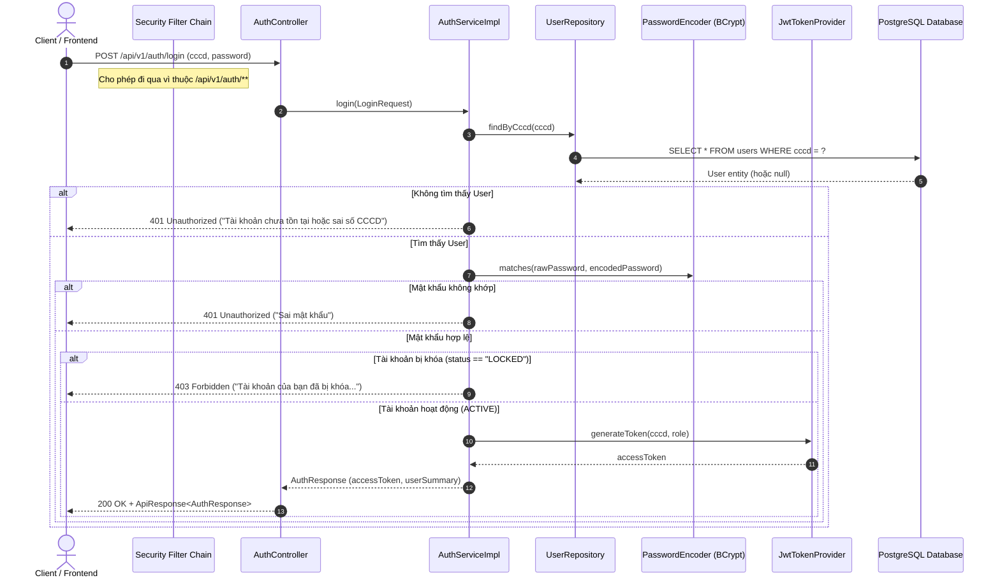
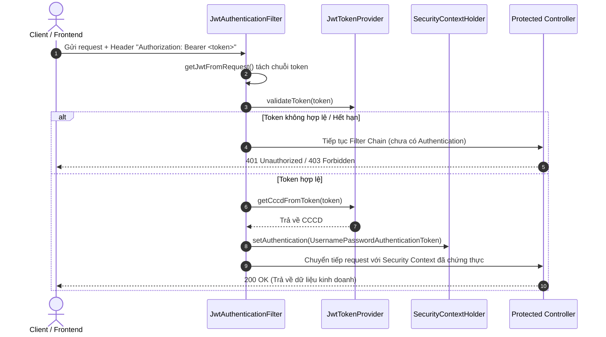

# TÀI LIỆU CHI TIẾT VỀ AUTHENTICATION & LOGIN (SRBMS BACKEND)

Tài liệu này giải thích chi tiết toàn bộ mã nguồn, kiến trúc và luồng vận hành của hệ thống xác thực (Authentication), đăng ký (Registration) và đăng nhập (Login) bằng **Spring Boot 3.3.4**, **Spring Security 6**, **JJWT (JSON Web Token)**, **BCrypt** và **PostgreSQL** trong dự án SRBMS Backend.

---

## 1. Tổng quan Kiến trúc Bảo mật (Security Architecture)

Hệ thống bảo mật được thiết kế theo mô hình **Stateless RESTful API** (phi trạng thái):
* **Không dùng HttpSession / Cookie**: Server không lưu trữ session của người dùng trên RAM.
* **Xác thực qua JWT (JSON Web Token)**: Khi đăng nhập thành công, máy chủ cấp cho client một chuỗi token JWT được ký điện tử (HMAC-SHA256). Token này mang theo danh tính (CCCD) và quyền hạn (Role) của người dùng.
* **Thời hạn Token**: Mặc định là **24 giờ** (`86400000 ms`), cấu hình tại `application.yml`.
* **Mã hóa mật khẩu**: Mật khẩu của người dùng được băm một chiều bằng thuật toán an toàn **BCrypt** với salt ngẫu nhiên trước khi lưu vào cơ sở dữ liệu.
* **Xác thực từng Request**: Mọi request gửi tới các endpoint được bảo vệ phải đính kèm Header:
  ```http
  Authorization: Bearer <token_jwt>
  ```

---

## 2. Sơ đồ Luồng Hoạt động (Sequence Diagrams)

### 2.1. Luồng Đăng nhập (Login Flow)



---

### 2.2. Luồng Xác thực Request được bảo vệ (Protected Requests)



---

## 3. Chi tiết các File Mã nguồn và Trách nhiệm

Toàn bộ logic xác thực được phân chia theo mô hình phân tầng chặt chẽ:

```
src/main/java/com/srbms/
├── config/
│   └── SecurityConfig.java              # Cấu hình Spring Security, lọc request, CORS
├── controller/
│   └── AuthController.java              # Nhận HTTP request cho /register và /login
├── dto/
│   ├── request/
│   │   ├── LoginRequest.java            # DTO dữ liệu gửi lên khi đăng nhập
│   │   └── RegisterRequest.java         # DTO dữ liệu gửi lên khi đăng ký (+ Validation)
│   └── response/
│       ├── ApiResponse.java             # Chuẩn hóa vỏ bọc kết quả trả về JSON
│       └── AuthResponse.java            # DTO trả về gồm Token + thông tin người dùng
├── entity/
│   └── User.java                        # Ánh xạ bảng "users" trong Database PostgreSQL
├── exception/
│   ├── AppException.java                # Ngoại lệ nghiệp vụ tùy chỉnh mang HttpStatus
│   └── GlobalExceptionHandler.java      # Bắt lỗi toàn cục, trả về JSON đồng nhất
├── repository/
│   └── UserRepository.java              # Tầng truy vấn DB với Spring Data JPA
├── security/
│   ├── JwtAuthenticationFilter.java     # Bộ lọc kiểm tra JWT trong từng Request
│   └── JwtTokenProvider.java            # Tạo, giải mã và xác thực chữ ký JWT Token
└── service/
    ├── AuthService.java                 # Interface định nghĩa nghiệp vụ xác thực
    └── impl/
        └── AuthServiceImpl.java         # Xử lý logic đăng ký, so sánh mật khẩu, cấp token
```

---

### 3.1. Tầng Thực thể: User.java

Lớp ánh xạ bảng `users` trong cơ sở dữ liệu PostgreSQL (`com.srbms.entity.User`):

| Thuộc tính | Kiểu dữ liệu | Ràng buộc | Mô tả |
| :--- | :--- | :--- | :--- |
| `id` | `Long` | Primary Key, Auto Increment | Khóa chính tự tăng |
| `cccd` | `String (12)` | `nullable = false, unique = true` | Số CCCD dùng làm định danh đăng nhập chính |
| `password` | `String` | `nullable = false` | Chuỗi mật khẩu đã được băm BCrypt |
| `username` | `String (50)` | `nullable = true` | Tên người dùng tùy chọn (mặc định lấy CCCD) |
| `fullName` | `String (100)`| `nullable = false` | Họ và tên chủ hộ / người dùng |
| `sdt` | `String (15)` | `nullable = false, unique = true` | Số điện thoại liên hệ |
| `email` | `String (100)`| `nullable = false, unique = true` | Địa chỉ email |
| `dateOfBirth`| `LocalDate` | `nullable = true` | Ngày tháng năm sinh |
| `role` | `String (30)` | Default: `"ROLE_USER"` | Vai trò của tài khoản |
| `status` | `String (20)` | Default: `"ACTIVE"` | Trạng thái tài khoản (`ACTIVE`, `LOCKED`) |
| `createdAt` | `LocalDateTime` | Auto timestamp | Thời gian tạo tài khoản |
| `updatedAt` | `LocalDateTime` | Auto timestamp | Thời gian cập nhật tài khoản lần cuối |

> **Chỉ mục (Indexes)**: Tạo sẵn 3 index riêng biệt: `idx_users_cccd`, `idx_users_email`, `idx_users_sdt` nhằm tối ưu tốc độ truy vấn khi đăng nhập và kiểm tra trùng lặp tài khoản.

---

### 3.2. Tầng Truy vấn: UserRepository.java

Cung cấp các phương thức truy vấn tối ưu thông qua Spring Data JPA (`com.srbms.repository.UserRepository`):
* `Optional<User> findByCccd(String cccd)`: Tìm tài khoản theo số CCCD để thực hiện đăng nhập.
* `boolean existsByCccd(String cccd)`: Kiểm tra CCCD đã được đăng ký trước đó chưa.
* `boolean existsByEmail(String email)`: Kiểm tra Email đã được đăng ký trước đó chưa.
* `boolean existsBySdt(String sdt)`: Kiểm tra Số điện thoại đã được đăng ký trước đó chưa.

---

### 3.3. Tầng DTO (Data Transfer Object)

#### A. RegisterRequest.java (`com.srbms.dto.request.RegisterRequest`)
Ràng buộc dữ liệu đầu vào nghiêm ngặt trước khi đến Service:
* `@NotBlank` và `@Pattern(regexp = "^[0-9]{12}$")`: CCCD phải đúng 12 chữ số.
* `@NotBlank` và `@Size(min = 6)`: Mật khẩu tối thiểu 6 ký tự.
* `@NotBlank` và `@Pattern(regexp = "^(0|\\+84)[0-9]{9}$")`: Số điện thoại chuẩn định dạng Việt Nam (10 số).
* `@NotBlank` và `@Email`: Email hợp lệ.

#### B. LoginRequest.java (`com.srbms.dto.request.LoginRequest`)
* `cccd`: Bắt buộc nhập.
* `password`: Bắt buộc nhập.

#### C. AuthResponse.java (`com.srbms.dto.response.AuthResponse`)
Kết quả trả về cho client sau khi đăng nhập thành công:
```json
{
  "accessToken": "eyJhbGciOiJIUzI1NiJ9...",
  "tokenType": "Bearer",
  "expiresIn": 86400000,
  "user": {
    "id": 1,
    "cccd": "079099001122",
    "username": "079099001122",
    "fullName": "Nguyễn Văn A",
    "email": "nguyenvana@gmail.com",
    "sdt": "0901234567",
    "role": "ROLE_USER",
    "status": "ACTIVE"
  }
}
```

#### D. ApiResponse.java (`com.srbms.dto.response.ApiResponse`)
Cấu trúc đóng gói đồng nhất cho toàn bộ hệ thống API:
```json
{
  "success": true,
  "message": "Đăng nhập thành công",
  "data": { ... }
}
```

---

### 3.4. Tầng Security & JWT

#### A. JwtTokenProvider.java (`com.srbms.security.JwtTokenProvider`)
* **`generateToken(String cccd, String role)`**:
  * Tạo payload chứa `Subject = cccd`, `claim("role", role)`.
  * Thiết lập thời gian phát hành (`IssuedAt`) và thời gian hết hạn (`Expiration = now + 86400000ms`).
  * Ký số bằng khóa bí mật bí mật `jwt.secret` (Base64) sử dụng thuật toán HMAC-SHA256.
* **`validateToken(String token)`**: Kiểm tra tính toàn vẹn của token, phát hiện nếu token bị giả mạo hoặc đã hết hạn.
* **`getCccdFromToken(String token)`**: Trích xuất số CCCD từ token để xác minh danh tính.

#### B. JwtAuthenticationFilter.java (`com.srbms.security.JwtAuthenticationFilter`)
* Kế thừa `OncePerRequestFilter` đảm bảo mỗi request HTTP chỉ đi qua filter này đúng 1 lần.
* Lấy chuỗi header `Authorization`. Nếu bắt đầu bằng `"Bearer "`, cắt 7 ký tự đầu để lấy token sạch.
* Nếu token hợp lệ:
  1. Trích xuất CCCD từ token.
  2. Tạo đối tượng `UsernamePasswordAuthenticationToken` gán quyền `ROLE_USER`.
  3. Đính kèm thông tin request (`WebAuthenticationDetailsSource`).
  4. Lưu vào `SecurityContextHolder.getContext().setAuthentication(authentication)` để các controller phía sau biết được ai đang thực hiện request.

#### C. SecurityConfig.java (`com.srbms.config.SecurityConfig`)
* Cung cấp Bean `PasswordEncoder`: Sử dụng `BCryptPasswordEncoder()`.
* Cấu hình chuỗi lọc bảo mật `SecurityFilterChain`:
  * `csrf(disable)`: Vô hiệu hóa bảo vệ CSRF do hệ thống dùng token stateless (không dùng session cookie).
  * `cors(...)`: Cho phép gọi API từ mọi nguồn (Cross-Origin Resource Sharing).
  * `sessionManagement`: Chế độ `SessionCreationPolicy.STATELESS`.
  * `authorizeHttpRequests`:
    * Cho phép truy cập không cần token: `/api/v1/auth/**`, `/error`.
    * Tất cả các đường dẫn khác: Bắt buộc phải có token hợp lệ (`authenticated()`).
  * `addFilterBefore(jwtAuthenticationFilter, UsernamePasswordAuthenticationFilter.class)`: Đặt bộ lọc JWT chạy trước bộ lọc đăng nhập mặc định của Spring.

---

### 3.5. Tầng Service: AuthServiceImpl.java (`com.srbms.service.impl.AuthServiceImpl`)

#### 1. Xử lý Đăng ký (`register`):
1. Kiểm tra sự tồn tại của CCCD: nếu đã có -> ném `AppException(409 Conflict, "Tài khoản đã tồn tại (Số CCCD này đã được đăng ký)")`.
2. Kiểm tra Email: nếu trùng -> ném `AppException(409 Conflict, "Địa chỉ Email này đã được đăng ký")`.
3. Kiểm tra SĐT: nếu trùng -> ném `AppException(409 Conflict, "Số điện thoại này đã được đăng ký")`.
4. Mã hóa mật khẩu: `passwordEncoder.encode(request.getPassword())`.
5. Tạo đối tượng `User` và lưu vào PostgreSQL.

#### 2. Xử lý Đăng nhập (`login`):
1. Tìm User theo CCCD: Nếu không thấy -> ném `AppException(401 Unauthorized, "Tài khoản chưa tồn tại hoặc sai số CCCD")`.
2. Kiểm tra mật khẩu: `passwordEncoder.matches(rawPassword, encodedPassword)`. Nếu sai -> ném `AppException(401 Unauthorized, "Sai mật khẩu")`.
3. Kiểm tra trạng thái tài khoản: Nếu `status` là `"LOCKED"` -> ném `AppException(403 Forbidden, "Tài khoản của bạn đã bị khóa. Vui lòng liên hệ quản trị viên")`.
4. Sinh JWT Token bằng `tokenProvider.generateToken(user.getCccd(), user.getRole())`.
5. Trả về đối tượng `AuthResponse` chứa token và thông tin người dùng.

---

### 3.6. Tầng Xử lý lỗi toàn cục: GlobalExceptionHandler.java (`com.srbms.exception.GlobalExceptionHandler`)

* Bắt `AppException`: Chuyển đúng mã HTTP Status (401, 403, 409, ...) và thông điệp lỗi dạng JSON:
  ```json
  {
    "success": false,
    "message": "Sai mật khẩu"
  }
  ```
* Bắt `MethodArgumentNotValidException`: Trả về HTTP 400 Bad Request kèm chi tiết từng trường bị lỗi validate (ví dụ: CCCD sai định dạng, mật khẩu ngắn hơn 6 ký tự).
* Bắt `Exception` thông thường: Trả về HTTP 500 Internal Server Error khi gặp lỗi chưa được định nghĩa.

---

## 4. Hướng dẫn Kiểm thử API (Postman / cURL)

### 4.1. Đăng ký tài khoản (Register)
* **Method**: `POST`
* **URL**: `http://localhost:8080/api/v1/auth/register`
* **Headers**: `Content-Type: application/json`
* **Body** (raw JSON):
  ```json
  {
    "cccd": "079099001122",
    "password": "Password123@",
    "fullName": "Nguyễn Văn A",
    "username": "nguyenvana",
    "sdt": "0901234567",
    "email": "nguyenvana@gmail.com",
    "dateOfBirth": "1995-05-20"
  }
  ```
* **Kết quả trả về**:
  * Thành công (201 Created):
    ```json
    {
      "success": true,
      "message": "Đăng ký tài khoản thành công"
    }
    ```
  * Lỗi trùng CCCD / Email / SĐT (409 Conflict):
    ```json
    {
      "success": false,
      "message": "Tài khoản đã tồn tại (Số CCCD này đã được đăng ký)"
    }
    ```

---

### 4.2. Đăng nhập (Login)
* **Method**: `POST`
* **URL**: `http://localhost:8080/api/v1/auth/login`
* **Headers**: `Content-Type: application/json`
* **Body** (raw JSON):
  ```json
  {
    "cccd": "079099001122",
    "password": "Password123@"
  }
  ```
* **Kết quả trả về**:
  * Thành công (200 OK):
    ```json
    {
      "success": true,
      "message": "Đăng nhập thành công",
      "data": {
        "accessToken": "eyJhbGciOiJIUzI1NiJ9.eyJzdWIiOiIwNzkwOTkwMDExMjIiLCJyb2xlIjoiUk9MRV9VU0VSIiwiaWF0IjoxNzg0ODQxNTU0LCJleHAiOjE3ODQ5Mjc5NTR9...",
        "tokenType": "Bearer",
        "expiresIn": 86400000,
        "user": {
          "id": 1,
          "cccd": "079099001122",
          "username": "nguyenvana",
          "fullName": "Nguyễn Văn A",
          "email": "nguyenvana@gmail.com",
          "sdt": "0901234567",
          "role": "ROLE_USER",
          "status": "ACTIVE"
        }
      }
    }
    ```
  * Sai tài khoản / CCCD chưa tồn tại (401 Unauthorized):
    ```json
    {
      "success": false,
      "message": "Tài khoản chưa tồn tại hoặc sai số CCCD"
    }
    ```
  * Sai mật khẩu (401 Unauthorized):
    ```json
    {
      "success": false,
      "message": "Sai mật khẩu"
    }
    ```

---

## 5. Sự phối hợp giữa Backend và Frontend UI trong tương lai

Một điểm quan trọng đối với yêu cầu: **"sau khi user login thành công sẽ vào trang chủ"**:
1. **Tại thời điểm hiện tại (chưa có UI)**:
   Backend là REST API thuần túy, đóng vai trò cung cấp dữ liệu. Khi nhận đúng CCCD và mật khẩu, Backend trả về JSON thành công kèm theo chuỗi `accessToken` (JWT).
2. **Khi phát triển Frontend UI (React, Vue, Flutter, HTML/JS...)**:
   * Frontend gửi `POST /api/v1/auth/login`.
   * Khi nhận response `success == true`:
     1. Frontend lưu `accessToken` vào `localStorage` hoặc `Cookie`.
     2. Lưu thông tin người dùng `data.user` vào State/Store để hiển thị tên trên thanh Header.
     3. **Frontend thực hiện lệnh điều hướng router** (ví dụ: `navigate('/dashboard')` hoặc `window.location.href = '/trang-chu'`).
   * Ở tất cả các trang sau đó, Frontend đính kèm token vào Header:
     `Authorization: Bearer <accessToken>` để truy cập các dữ liệu được bảo vệ.
